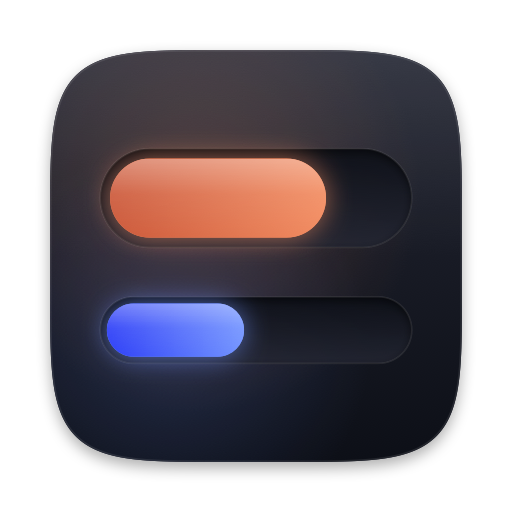
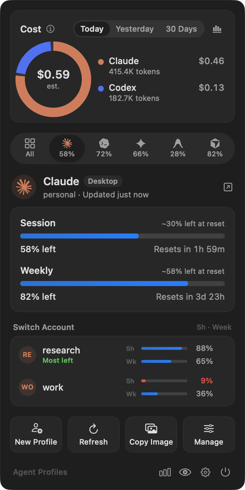
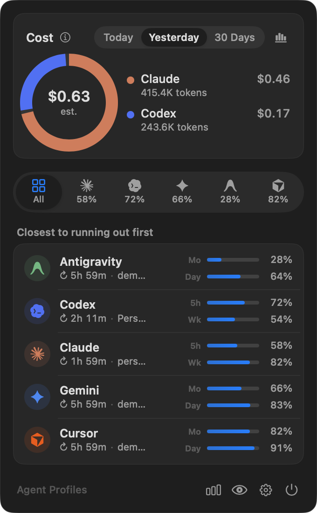

# Agent Profiles



A macOS menu bar app that switches between your Claude and Codex accounts and
shows how much each one has left — plus the usage of your other AI coding
tools, in one panel.



macOS 14 or later, Apple Silicon or Intel. Independently developed; not
affiliated with or endorsed by Anthropic, OpenAI or any other provider.

## Features

**Accounts**
- One click switches Claude Desktop, Claude Code (CLI) or Codex to another
  saved account. Each account row shows its 5-hour and weekly windows side by
  side, sorted by what is left, with the best one marked.
- Existing logins are picked up on their own; Settings handles naming,
  ordering, favorites, removal and sign-in.

**Usage**
- Session (5-hour) and weekly limits with reset countdowns, plus whatever else
  the account has: Claude's per-model weekly limits (Sonnet, Opus) and extra
  usage spend, Codex Spark windows, credits, workspace credit limits and limit
  resets.
- Pace: a bar turns yellow when the current burn rate would leave less than
  10% at the reset and red with the projected run-out time when it would run
  out first; a tick marks where an even burn would be.
- Click a percentage to switch between *left* and *used*, or a reset to switch
  between a countdown and a clock time. Both are also in Settings.
- Status-page incidents for each provider show on its card and tab.

**Cost**
- Estimated spend for Today, Yesterday and the last 30 days from local Claude
  Code and Codex logs, priced at API list rates from a bundled
  [LiteLLM](https://github.com/BerriAI/litellm) snapshot. Open the chart for
  daily bars and the most expensive models; hover a day for its breakdown.
- It is an estimate: Claude Desktop chats keep no local token log, and on a
  subscription it is the value of what you used, not a bill.

**History**
- Settings → History shows how each account's session or weekly limit filled
  over the last 7 or 30 days, one line per account. Hover for the values at a
  moment; the table below gives each account's latest, peak and how often the
  limit reached 100%. The readings are kept while the app runs (at most one
  per account every ten minutes, for 30 days, on this Mac only).

**Notifications**
- Low usage at a warning and a critical level you choose (25% and 10% left by
  default), and when a limit is used up. A critical Claude or Codex alert
  suggests the account with the most left; clicking it switches.
- "Will run out before it resets" from the pace, "a used-up limit has reset",
  and, if you turn it on, "weekly limit resets tomorrow with most of it unused".
- Each fires once per window, at the deepest level reached.

**More providers**
- Gemini, Antigravity, Cursor, GitHub Copilot, OpenCode, Kiro and Grok, each
  turned on in Settings → More Providers. An Overview tab then lists every
  provider, closest to running out first.

  

**Menu bar**
- A two-bar icon, the session window on top and the weekly one below, with the
  session, weekly or lower percentage next to it. It follows the frontmost
  Claude or Codex app, or the provider picked in Settings.
- ⌘⌥0 opens the panel. *Copy Image* puts the current card on the clipboard
  with email addresses masked; the eye button masks them in the panel too.

## Providers

| Provider | What it shows | Where the numbers come from |
| --- | --- | --- |
| Claude | Session, weekly, per-model weekly, extra usage | Claude Desktop's own cached usage response, read from disk. No token is read and no request is made. |
| Codex | Session, weekly, Spark, credits, credit limit, limit resets | ChatGPT's usage API, with each saved account's login. |
| Gemini | Pro, Flash and Flash Lite quotas, plan | Gemini CLI's sign-in and Google's Code Assist quota API. Workspace and Code Assist Standard/Enterprise accounts; Google moved individual and AI Pro/Ultra accounts to Antigravity in June 2026. |
| Antigravity | 5-hour and weekly model pools | The sign-in the Antigravity app and `agy` share (its Keychain item, read without a prompt, or `agy`'s file token store) and Google's Cloud Code API. |
| Cursor | Plan usage, on-demand spend | The Cursor app's or `cursor-agent`'s sign-in and cursor.com's dashboard API. |
| GitHub Copilot | Premium requests, chat, completions | The GitHub token the JetBrains/Vim/Xcode plugins or the Copilot CLI keep in plain text. VS Code keeps its sign-in in the Keychain, which isn't read. |
| OpenCode | Go plan session, weekly and monthly | OpenCode's own sign-in or `OPENCODE_API_KEY`. |
| Kiro | Credits and overage | kiro-cli's sign-in. Run kiro-cli again when it lapses; it isn't renewed here. |
| Grok | Weekly or monthly credits, on-demand balance | Grok CLI's sign-in. |

Extra providers are off until you turn them on. They only read the sign-in
their own tool keeps on this Mac and never change it; tokens refreshed for a
request stay in memory. See [Privacy](PRIVACY.md).

## Install

1. Download `AgentProfiles-<version>.zip` from [Releases](https://github.com/ajipurn/agent-profiles/releases/latest).
2. Unzip it and move **Agent Profiles.app** to **Applications**.
3. If you use Claude Profiles or Codex Profiles, quit them; Agent Profiles
   takes over their profiles and accounts as they are.
4. Open Agent Profiles and click its icon in the menu bar.

<details>
<summary><b>"Apple could not verify Agent Profiles…"</b></summary>

Releases are ad-hoc signed, not notarized (that needs a paid Apple Developer
account), so macOS warns on the first launch. Nothing was detected. Pick one,
once:

- **System Settings:** click **Done** in the warning, open **Privacy &
  Security**, scroll to *"Agent Profiles" was blocked…* and click **Open
  Anyway**.
- **Terminal:**

  ```sh
  xattr -dr com.apple.quarantine "/Applications/Agent Profiles.app"
  ```

Later versions arrive through the built-in updater, which checks Sparkle's
Ed25519 signature before installing. Building from source avoids the warning.
</details>

## Shortcuts and scripting

| Shortcut | Does |
| --- | --- |
| ⌘⌥0 | opens the panel (can be turned off) |
| ⌘⌥1…9 | switches to the Nth Claude profile, in the order set in Settings |
| ⌃⌥1…9 | switches to the Nth Codex account, favorites first, then by name |
| ⌘R, ⌘,, ⌘Q | refresh, Settings and quit, while the panel is open |

| URL (Raycast, Alfred, shell) | Does |
| --- | --- |
| `agentprofiles://claude/<name>` | switches Claude Desktop |
| `agentprofiles://claude-cli/<name>` | switches the Claude Code profile (`Default` = plain `~/.claude`) |
| `agentprofiles://codex/<name>` | switches Codex (saved name, label or email) |
| `agentprofiles://open[/<pane>]` | opens Settings (`general`, `notifications`, `claude`, `codex`, `providers`, `history`, `about`) |

Claude Profiles' `claudeprofiles://switch|switch-cli|open` still work.

### Command line

The app carries an `agent-profiles` command. Link it into a folder on your
PATH once:

```sh
ln -s "/Applications/Agent Profiles.app/Contents/Helpers/agent-profiles" /usr/local/bin/
```

| Command | Does |
| --- | --- |
| `agent-profiles` (or `status`) | the active Claude Desktop profile with its usage, the Claude Code profile and the Codex account |
| `agent-profiles list [claude\|claude-cli\|codex]` | profiles and accounts, `*` on the active ones |
| `agent-profiles usage [claude\|codex]` | Claude Desktop usage as Claude last saw it; the active Codex account's usage, fetched now |
| `agent-profiles cost` | the estimated cost, as in the panel |
| `agent-profiles history [claude\|codex] [--days N]` | each account's peaks over the last 7 days (up to 30) and how often a limit filled up, from the readings behind Settings → History; `--json` adds every reading |
| `agent-profiles switch claude\|claude-cli\|codex <name>` | switches through the app, like the URLs above, and waits until it is done (`--no-wait` doesn't) |

Add `--json` for scripts and status lines. Reading needs nothing running; a
switch opens the app if it is not running.

## Existing logins

- **Codex:** a login in `~/.codex/auth.json` that no saved account matches is
  saved on its own, named after its email. Removing the active account keeps
  it from being saved again.
- **Claude:** if Claude is signed in but profiles were never set up, the
  current login becomes the first profile ("main") while Claude.app is quit.
  With Claude running, use *Set Up Profiles…*. Any profile can be deleted,
  including the active and the last one; deleting the active Desktop profile
  closes Claude, and deleting the active or last one stops automatic setup
  until you choose *Set Up Profiles…* again.
- **Shared session history** (Settings → Claude) merges every profile's
  Claude Code sessions into one list, after a timestamped backup in your home
  folder. *Restore from backup* gives each profile its own sessions back, also
  for profiles renamed since the backup.

## Build from source

```sh
make test   # Codex checks and the Swift test suites
make demo   # preview: sample accounts in temporary folders
make run    # real mode: manages your actual accounts
make icon   # redraws the app icon (scripts/make-icon.swift)
```

The preview (`--demo`) never quits or relaunches Claude or ChatGPT and makes
no usage requests, so it is safe next to the real app. It shares the real
app's preferences, though: picking a tab there changes "Show usage for".

Only the Command Line Tools are needed. The scripts use SwiftPM's native build
system and, when the default SDK is macOS 27, build against the macOS 26 SDK;
`scripts/swift-env.sh` explains why. Every target builds in Swift 6 language
mode. See [Contributing](CONTRIBUTING.md) and the [release guide](docs/RELEASING.md).

### Layout

```
Sources/PlatformSupport/     paths, links, file modes per OS
Sources/CZstd/               vendored zstd, decompress only (BSD)
Sources/ClaudeProfilesCore/  Claude profiles and cached usage, no UI
Sources/CodexProfilesCore/   Codex accounts and usage API, no UI
Sources/ProvidersCore/       extra providers and status pages, no UI
Sources/UsageCostCore/       cost estimate from local logs, no UI
Sources/UsageHistoryCore/    a month of usage readings for History, no UI
Sources/AgentCLI/            the agent-profiles command, no UI
Sources/AgentProfilesCLI/    its executable
Sources/AgentUI/             panel cards, bars, alerts, menu bar icon
Sources/CodexProfilesUI/     Codex model, settings pane, updater
Sources/AgentProfiles/       app shell, panel, Settings, Claude pane
Tests/                       Swift Testing suites, plus plain Codex checks
```

### Compatibility with the old apps

These must not change, or existing installs break:

- `~/Library/Application Support/Claude-Profiles/` stays where it is. The
  `Claude` symlink points into it, Claude Code ties each CLI profile's login to
  its folder path, and users' `~/.zshrc` puts `_cli/bin` on `PATH`.
- `~/Library/Application Support/CodexProfiles/` stays where it is.
- The `claudeprofiles://` URL scheme stays registered.
- Agent Profiles never runs at the same time as either old app (checked at
  launch).

The code was imported from
[claude-profiles](https://github.com/ajipurn/claude-profiles)@0c934d9 and
[codex-profiles](https://github.com/ajipurn/codex-profiles)@47210c3; earlier
history stays in those repositories.

## Credits

The panel's design, the alerts and the extra providers follow
[OpenUsage](https://github.com/robinebers/openusage) by Robin Ebers and
[CodexBar](https://github.com/steipete/CodexBar) by Peter Steinberger.
Provider marks are from [Lobe Icons](https://github.com/lobehub/lobe-icons).
The app icon is drawn in code by `scripts/make-icon.swift`.

## License

[MIT](LICENSE). Bundled dependencies keep their own
[licenses and notices](THIRD_PARTY_NOTICES.md). See also [Privacy](PRIVACY.md)
and [Security](SECURITY.md).
